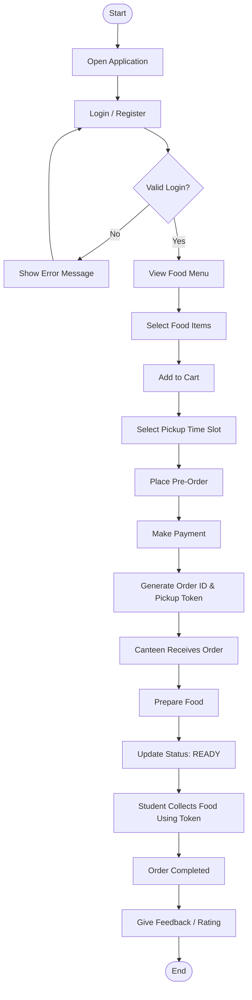
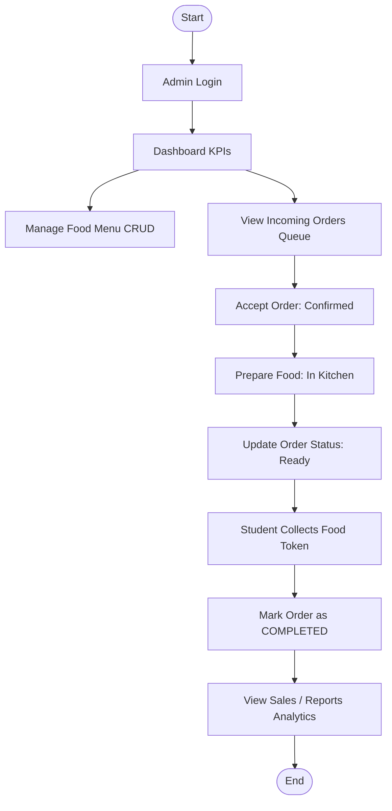

# 🍱 SmartCanteen – Online Food Pre-Ordering and Queue Management System

A production-ready, interactive web application built strictly according to the **SmartCanteen Flowchart Architecture**. Designed with clean, modular, intermediate-level coding patterns (HTML5, Vanilla CSS, and Modular ES6 JavaScript) with zero external runtime dependencies.

---

## 🎯 Flowchart Coverage & Feature Mapping

This application strictly implements all three flows and system architecture defined in the specification:

### 1. 👨‍🎓 Student Flow


- **Login / Register**: Built-in credential validation, welcome wallet bonus (₹300), and 1-click test login buttons.
- **View Food Menu**: Filter by Category (Breakfast, Lunch, Snacks, Beverages, Desserts), Diet (🟢 Veg / 🔴 Non-Veg), Search query, and Sort by price/prep time/popularity.
- **Add to Cart & Select Pickup Time**: Choose from presets (`ASAP ~10-15m`, `In 30m`, `Lunch Break 1:15 PM`, `Evening 4:30 PM`, or `Custom Time Slot`), add kitchen instructions (e.g., "extra spicy").
- **Make Payment**: Interactive payment modal simulating UPI QR scan (GPay/PhonePe), Campus Digital Wallet (with live deduction), Debit Card, or Pay at Counter.
- **Order ID & Token Generation**: Instantly issues a unique **Pickup Token (e.g., #T-105)** and **Order ID (e.g., ORD-9412)** with a digital QR card.
- **Live 5-Stage Status Tracking**: Real-time status stepper with glowing visual progression:
  `PENDING` ➔ `CONFIRMED` ➔ `PREPARING` ➔ `READY` ➔ `COMPLETED`.
- **Collect Food & Sound Alert**: Chimes when status updates to `READY`! Student can verify token at Counter #2 and collect food.
- **Rating & Feedback**: 5-star interactive rating, compliment tags, and written feedback directly logged to the admin dashboard.

---

### 2. 👨‍🍳 Admin / Canteen Flow


- **Dashboard**: Real-time KPI summary (Pending Orders, Cooking in Kitchen, Ready for Pickup, Completed Today, Total Revenue).
- **Manage Food Menu (CRUD)**:
  - Add new dishes with photos, categories, prep times, calories, and prices.
  - Edit existing items.
  - Delete items.
  - Instant **"In Stock / Sold Out"** toggle switch.
- **Kitchen Display System (KDS)**: Kanban queue with filter tabs and token search.
- **1-Click Status Lifecycle**:
  - `Accept Order` (moves `PENDING` ➔ `CONFIRMED`)
  - `Start Cooking` (moves `CONFIRMED` ➔ `PREPARING`)
  - `Mark Ready` (moves `PREPARING` ➔ `READY` — automatically rings student notification!)
  - `Handover & Complete` (moves `READY` ➔ `COMPLETED`).
- **Sales & Reports Analytics**:
  - Gross sales & average ticket value.
  - Hourly peak order volume bar chart (breakfast vs lunch rush analysis).
  - Top 5 best-selling dishes ranking.
  - Live student feedback and review wall.

---

### 3. ⚡ System Architecture
| Layer | Technology Used | Implementation Description |
| :--- | :--- | :--- |
| **Frontend** | HTML5, CSS3, Modern JS | Clean semantic HTML, custom CSS property design system, responsive layout. |
| **State & Store** | `localStorage` + `BroadcastChannel` | Real-time multi-tab synchronization without external dependencies. |
| **Audio Synthesis** | Web Audio API | Zero-asset synthetic bell and chime alerts (`audio.js`). |
| **Backend Server** | Node.js native `http` | Zero-dependency static server with health endpoint (`server.js`). |

---

## 🚀 How to Run the Application

### Option A: Using the Local Node.js Server (Recommended)
1. Open PowerShell or Terminal in the project root:
   ```bash
   cd C:\Users\shyam\.gemini\antigravity-ide\scratch\smart-canteen
   ```
2. Start the server (no `npm install` needed!):
   ```bash
   node server.js
   ```
3. Open your browser at:
   ```
   http://localhost:3000
   ```

### Option B: Direct Browser Opening
Simply double-click or open `index.html` in Chrome, Edge, Firefox, or Safari. All features (including state persistence and audio) work immediately out of the box!

---

## 💡 Demo Features That Wow

1. **⚡ Live Split-Screen Demo Mode**:
   Click **"Live Split Demo"** in the top navigation bar. The screen splits side-by-side: place a pre-order on the left (Student Portal), and immediately watch it arrive and update in the kitchen queue on the right in real time!
2. **📺 Cafeteria Big-Screen Token TV Board**:
   Click **"Token TV Board"** to view a full-screen cafeteria display with pulsing tokens under **NOW PREPARING** and glowing green tokens under **READY FOR PICKUP AT COUNTER #2**.
3. **🔔 Native Web Audio Chimes**:
   Uses the browser's built-in `AudioContext` to play melodic confirmation sounds on order placement, kitchen dings on incoming orders, and celebratory chimes when food is marked ready!

---

## 🔑 Pre-Configured Test Credentials

| Role | Email | Password | Quick Action |
| :--- | :--- | :--- | :--- |
| **Student** | `student@campus.edu` | `student123` | Click *"👨‍🎓 Fill Demo Student"* in Login Modal |
| **Admin** | `admin@canteen.edu` | `admin123` | Click *"👨‍🍳 Fill Demo Admin"* in Login Modal |

---

## 📁 File Structure
```
smart-canteen/
├── index.html          # Main application page with semantic views & modals
├── package.json        # Project metadata and run scripts
├── server.js           # Zero-dependency Node.js HTTP server
├── css/
│   └── style.css       # Complete modern CSS design system & responsive layout
├── js/
│   ├── data.js         # Initial seed items, categories, slots, and orders
│   ├── audio.js        # Native Web Audio API synth sounds
│   ├── store.js        # State store, LocalStorage CRUD & cross-tab sync
│   ├── student.js      # Student workflow controller
│   ├── admin.js        # Admin & Kitchen workflow controller
│   └── app.js          # App orchestrator, auth, TV board, and toasts
└── README.md           # Project documentation & architecture guide
```
